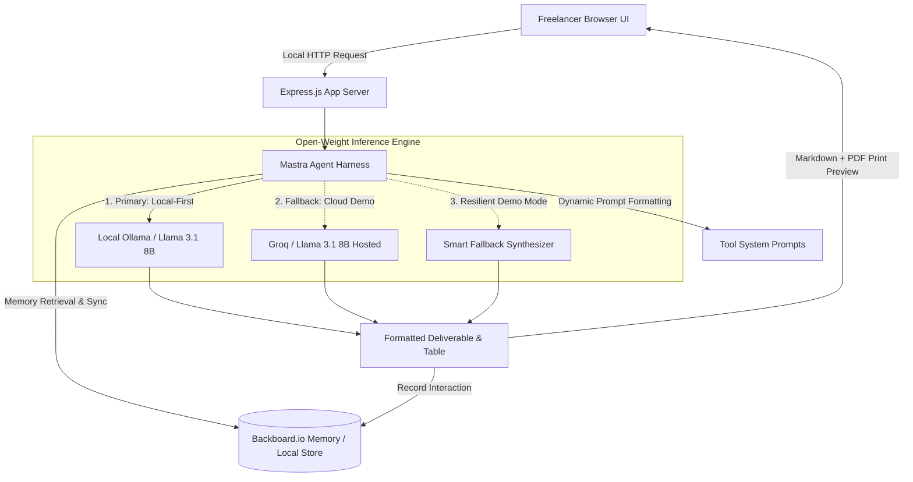

# FreelanceForge AI

A local-first, open-weight AI workspace for freelancers to draft proposals, itemize invoices, establish scope boundaries, and manage client communications.

[](LICENSE)
[](https://nodejs.org/)
[](https://ollama.ai)
[](render.yaml)
[](https://backboard.io)

*Submission for the [Hacktoberfest Open-Source AI Challenge Week 2: Side Hustle](https://dev.to/challenges/hacktoberfest-week2-2026-10-12).*

---

## Overview

Administrative work like drafting proposals, detailing invoices, defining scope, and handling awkward client emails can take up a significant portion of a freelancer's working hours. 

FreelanceForge AI is an open-source, local-first application built to handle these tasks directly on your machine. Instead of sending sensitive project notes to third-party proprietary services, it uses local open weights (Llama 3.1 8B via Ollama) and persistent memory via Backboard.io to generate structured, client-ready documents.

### Key Tools

- **Proposal Draft:** Converts unorganized meeting notes or audio memos into structured proposals with milestone schedules, deliverable breakdowns, and payment terms.
- **Invoice Value Justifier:** Translates task lists, hours, or Git commits into business-outcome line items for client billing.
- **Scope Guardian:** Analyzes new client requests against original agreements, generating a clear Statement of Work (SOW) boundary document, an add-on quote, and a response script.
- **Client Diplomat:** Provides communication templates with three selectable tones (Warm, Firm, Direct) for situations like overdue payments or scope adjustments.
- **Voice Dictation:** Uses the browser's Web Speech API to transcribe voice notes in real time and automatically structure them into project briefs.
- **Prompt Transparency:** Allows users to inspect and customize the underlying system prompts directly in the interface to match their preferred tone, contract terms, or local legal requirements.

---

## Why Local-First Open Weights

1. **Client Confidentiality:** Freelancers frequently handle non-disclosure agreements, unreleased product roadmaps, and private financial agreements. Local inference via Ollama ensures that client data never leaves the developer's laptop.
2. **Zero Marginal Token Costs:** Commercial API fees add up quickly when generating long-form proposals and detailed invoices. Running local weights costs nothing per token.
3. **Model Flexibility:** No vendor lock-in. The backend can route between local Ollama instances, hosted open-weight fallbacks (such as Groq for cloud demos), or offline template synthesizers based on configuration.

---

## Architecture



---

## Partner Categories

### Best Use of Backboard ($100 Partner Category)
FreelanceForge AI integrates **Backboard.io** (`backboard-sdk`) for persistent client memory and rate context:
- **Rate & Term Extraction:** Automatically parses agreed hourly rates (e.g., `$95/hr`), fixed pricing, and payment terms (`Net 15`, `50% deposit`) from generated deliverables.
- **RAG Context Injection:** When a returning client name is provided, the application retrieves their historical terms from Backboard and injects them into the prompt to preserve pricing consistency.
- **Right to Be Forgotten:** Allows users to view and delete stored client records directly from the interface.
- **Dual-Mode Operation:** Connects to Backboard Cloud when `BACKBOARD_API_KEY` is configured, with a local persistent fallback when offline.

---

## Getting Started

### 1. Prerequisites (Ollama Setup)

To run models locally, install Ollama:

- **Windows (PowerShell):**
  ```powershell
  irm https://ollama.com/install.ps1 | iex
  ```
- **macOS / Linux:**
  ```bash
  curl -fsSL https://ollama.com/install.sh | sh
  ```
- Or download the installer directly from [ollama.com](https://ollama.com/download).

Pull the default model:
```bash
ollama pull llama3.1:8b
```

Verify that the local daemon is running:
```bash
curl http://localhost:11434/api/tags
```

---

### 2. Installation

```bash
git clone https://github.com/pythonperfec/freelanceforge-ai.git
cd freelanceforge-ai
npm install
```

### 3. Environment Configuration

```bash
cp .env.example .env
```

Set any optional API keys in `.env`:
- `BACKBOARD_API_KEY`: Backboard.io key for cloud client memory.
- `GROQ_API_KEY`: Groq key for cloud demo fallback when Ollama is unavailable.

### 4. Running Tests

Run the test suite to verify memory integration and provider priority logic:
```bash
npm test
```

### 5. Start Application

```bash
npm start
```

Open [http://localhost:3000](http://localhost:3000) in your browser.

You can check system status and active engine availability at:
```bash
curl http://localhost:3000/api/health
```

---

## Deployment (Render)

The repository includes both `render.yaml` and `render.yml` configured for the Render Free tier:

1. Push your repository to GitHub.
2. In the [Render Dashboard](https://dashboard.render.com), select **New +** → **Blueprint**.
3. Connect your repository. Render will automatically read the configuration and set up the service on the free plan.
4. Add `BACKBOARD_API_KEY` and `GROQ_API_KEY` under Environment Variables.

---

## Notes & Technical Considerations

- **Hardware Recommendations:** Running Llama 3.1 8B locally performs best on systems with at least 8 GB of unified memory/VRAM (or 16 GB of system RAM for CPU inference). When hardware constraints prevent local execution, the server routes to the configured cloud fallback or offline template synthesizer.
- **Data Privacy:** Local execution runs entirely on-device with no data sent to external servers. If using the hosted cloud demo, inference routes through Groq open weights.
- **Compliance:** Generated proposals and invoices are structured templates. Users should review them for local tax and contract regulations before sending them to clients.

---

## License

This project is licensed under the [MIT License](LICENSE).
