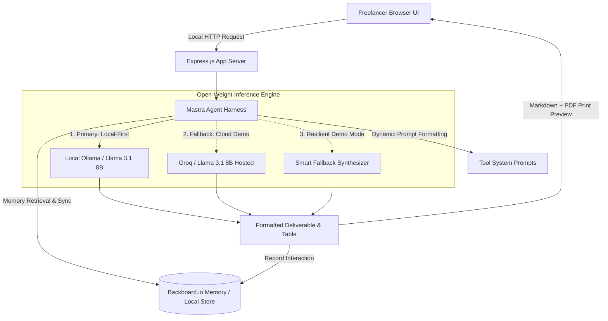

# ⚡ FreelanceForge AI
### *Local-First Open-Weight AI Suite for High-Value Freelancers*

[](LICENSE)
[](https://nodejs.org/)
[](https://ollama.ai)
[](render.yaml)
[](https://backboard.io)

> **Submission for the [Hacktoberfest Open-Source AI Challenge Week 2: Side Hustle](https://dev.to/challenges/hacktoberfest-week2-2026-10-12)**

---

## 🎯 What It Does

Freelancers lose up to **30% of their billable hours** to administrative friction: writing proposals, itemizing invoices, negotiating scope creep, and drafting diplomatic replies to difficult client messages.

**FreelanceForge AI** is an open-source, local-first toolkit that turns messy audio notes, bullet points, and Slack messages into polished, client-ready deliverables:

1. 📄 **Project Proposal Generator:** Converts rough scoping bullets and audio voice memos into comprehensive 5-figure project proposals with deliverables, timelines, and payment terms.
2. 🧾 **Invoice Value Justifier:** Translates technical commits and hours into executive business ROI breakdowns that clients pay without dispute.
3. 🛡️ **Scope Guardian:** Shields freelancers from unpaid scope creep by generating airtight Statement of Work (SOW) boundary documents with add-on rate menus.
4. 💬 **Client Diplomat:** Generates 3 diplomatic, boundary-setting response strategies (Warm, Firm, Direct) to navigate delicate situations like delayed payments or pushy deadlines.
5. 🎙️ **Voice-Note Dictation:** Record spontaneous voice memos immediately after a client call; the built-in speech engine transcribes it on the fly and auto-formats it into a structured brief.
6. 🔍 **Prompt Transparency (Change How Your Agent Behaves):** Unlike closed SaaS tools where system prompts are black boxes, FreelanceForge exposes the exact system prompt governing Llama 3.1 for every tool. Freelancers can inspect and edit it directly to customize tone, inject custom contract clauses, or fine-tune formatting.

---

## 💡 Why Open Innovation Matters

Running an open-weight model locally solves the fatal flaws of commercial closed-source AI wrappers:

| Challenge with Closed APIs | How FreelanceForge AI Wins with Open Innovation |
|---|---|
| **NDA Violations & Data Leaks:** Clients require confidentiality; sending unreleased product roadmaps to cloud APIs breaches contract terms. | **100% On-Device Privacy:** With Ollama and Llama 3.1 8B, data never leaves the freelancer's machine. Zero server telemetry. |
| **Crushing Metered SaaS Fees:** Commercial API tokens eat 15–20% of an independent freelancer's margin. | **$0 Marginal Token Cost:** Running local open weights costs exactly $0 per generation. Permanent 100% gross profit margin. |
| **Black-Box System Prompts:** Closed tools hide their prompts behind proprietary locks, preventing you from changing how the agent reasons. | **Prompt Transparency:** Inspect, edit, and fine-tune the exact system instructions governing the model on the fly. |
| **Vendor Lock-in & Deprecation:** Closed providers deprecate system prompt behaviors and hike pricing without warning. | **Model Portability:** Switch freely between Llama 3.1, Mistral, Gemma 2, or domain-tuned weights with one line in `.env`. |

---

## 🏗️ Architecture



---

## 🏆 Partner Technologies Used

- **Render ($50 Hacktoberfest Credit):** Configured via `render.yaml` for instant 1-click cloud deployment and public demo testing.
- **Backboard.io ($5 Hacktoberfest Credit):** Integrated via `backboard-sdk` to remember client history, past rates, and tone preferences across freelance projects.
- **Mastra AI:** Utilized as the modular agent harness to orchestrate memory retrieval, tool prompt synthesis, and multi-model dispatch.
- **Llama 3.1 8B (Meta / Open-Weights):** Runs locally via Ollama under permissive open-weight licensing.

---

## 🚀 Quick Start (Local Setup)

### 1. Prerequisites & Ollama Setup

FreelanceForge AI is designed to run 100% locally with open-weight models.

#### Install Ollama:
- **Windows (PowerShell):**
  ```powershell
  irm https://ollama.com/install.ps1 | iex
  ```
- **macOS / Linux:**
  ```bash
  curl -fsSL https://ollama.com/install.sh | sh
  ```
- Or download the installer directly from [ollama.com/download](https://ollama.com/download).

#### Pull the Open-Weight Model:
```bash
ollama pull llama3.1:8b
```

#### Verify Ollama is Ready:
```bash
curl http://localhost:11434/api/tags
```
If `llama3.1:8b` appears in the list, local inference is ready.

---

### 2. Clone & Install
```bash
git clone https://github.com/Ishan-Khan/freelanceforge-ai.git
cd freelanceforge-ai
npm install
```

### 3. Configure Environment
```bash
cp .env.example .env
```
*(Optional)* Add your `BACKBOARD_API_KEY` or `GROQ_API_KEY` for cloud fallbacks or hosted demos.

### 4. Run Tests
Validate the multi-tier engine selection priority (Ollama -> Groq -> Synthesizer):
```bash
npm test
```

### 5. Start the Server
```bash
npm start
```
Visit **[http://localhost:3000](http://localhost:3000)** in your browser!

You can also check the live engine health status anytime at:
```bash
curl http://localhost:3000/api/health
```

---

## ☁️ Deploy to Render in 1 Click

1. Fork or push this repository to GitHub.
2. In [Render Dashboard](https://dashboard.render.com), click **New +** → **Blueprint**.
3. Connect your repository. Render automatically reads `render.yaml` and deploys the service.
4. Add your `GROQ_API_KEY` (free open-weight fallback) in Render environment variables for the live demo.

---

## ⚠️ Limitations & Good to Know

- **Local Hardware Requirements:** Running Llama 3.1 8B locally requires at least 8 GB of unified memory/VRAM (or 16 GB system RAM on CPU). If hardware limits are reached, FreelanceForge seamlessly routes to the hosted Groq fallback or the offline template synthesizer.
- **Hosted Cloud Demo Data Privacy:** When testing the live hosted demo (e.g. on Render), inference runs via Groq Cloud open-weights rather than on-device. For confidential NDA client projects, always run FreelanceForge locally with Ollama.
- **Legal & Tax Advisory:** Invoices and Statements of Work generated by FreelanceForge are structured templates; freelancers should review local contract and tax compliance laws before issuing binding commercial agreements.

---

## 📄 License
This project is open-source under the **[MIT License](LICENSE)**. Built for the community with open-source AI.
